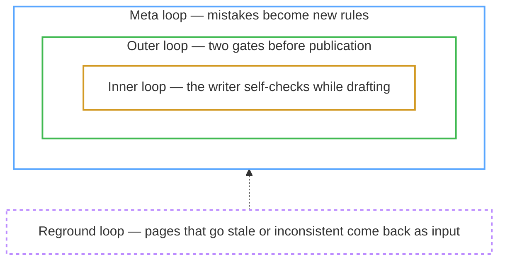

# LLM Wiki Newsroom

[](LICENSE)

**A multi-agent AI knowledge base run by a five-role "newsroom" — open-source, local-first, no vendor lock-in.** Drop articles, documents, and PDFs into the `raw/` folder, type a single command, and the newsroom — powered by an agent like Claude Code — reads them, extracts entities, concepts, and relationships, and organizes everything into a fully cross-referenced wiki, a structured and persistent alternative to RAG. Unlike most takes on the idea, the agent that *writes* a page is never the one that *reviews* it, and the authoring guidelines evolve themselves over time. Every new document you add also enriches the existing pages. This repo ships with a small example corpus — the debate over what "open source" means for AI — under `wiki/`, but the framework is domain-agnostic.

> Most knowledge tools leave the *finding* to you. This project **makes the AI read and understand** your collected documents first, then organizes them into a wiki — with cross-references between pages, automatic flagging of conflicting claims, and per-topic synthesis built in from the start, so later retrieval is fast.

> **See the output before installing** — the example corpus shipped in this repo is published as a browsable **[GitHub Wiki](https://github.com/alfadur7/llm-wiki-newsroom/wiki)** (no clone needed). It's a rendered static snapshot of the `wiki/` folder; the interactive graph below runs locally.


<sub>The interactive knowledge graph (`graph/graph.html`) — every page a node, every wikilink an edge, color-coded by auto-detected cluster, with a live physics layout and filter/search built in. Shown here on a larger private deployment (~2,300 nodes) to convey how it scales; **this repo ships a deliberately small example corpus** you can browse the exact same way. (Interface shown in the optional Korean `WIKI_LANG=ko` mode.)</sub>

## The concept

This project is one question worked into a running system: **how far can you trust knowledge an AI wrote?** Two ideas organize everything below.

**1. The product is an [LLM Wiki](https://gist.github.com/karpathy/442a6bf555914893e9891c11519de94f) — Andrej Karpathy's three-layer pattern.** The original documents you collect (Layer 1, `raw/`), the cross-linked wiki the agent maintains (Layer 2, `wiki/`), and the operating rules the agent follows (Layer 3, `CLAUDE.md` + `.claude/`) are kept strictly separate, so humans and AI don't trespass into each other's territory. As the operator you do exactly two things — feed Layer 1 and tune Layer 3; **only the agent writes Layer 2**. And ingesting one document doesn't just add a page: it refreshes the ~10–15 existing pages that mention the same entities and concepts, which is what makes the wiki compound instead of just piling up.

**2. The factory is a newsroom running four loops.** The wiki is produced by five roles modeled on a newspaper staff — and the agent that *writes* a page is never the one that *reviews* it:

| Role | What it does |
|---|---|
| **Reporter** | gathers material and drafts source pages + entity/concept stubs |
| **Columnist** | writes the deep cross-source analyses |
| **Copy Editor** | rule-based Python checks — not an LLM at all |
| **Desk** | re-reads finished drafts with fresh eyes; the only independent qualitative judgment in the system |
| **Editor-in-Chief** | routes work and gates publication — orchestration, not evaluation |

Four loops turn that division of labor into trust. The first three nest inside one another; only the fourth sits outside, feeding published pages back in:



| Loop | When it runs | What it does |
|---|---|---|
| **Inner** | while drafting | the writer self-checks against the same yardstick the review gates will use later, and hands off instead of grinding |
| **Outer** | at publication | two gates — deterministic lint (Copy Editor), then a six-lens qualitative review (Desk) — and both must pass |
| **Meta** | when mistakes recur | repeat failures become proposals to amend the authoring rules themselves — blind measurement where it applies, operator sign-off always |
| **Reground** | after publication | published pages that have gone stale or inconsistent come back around as factory input |

One piece of the machinery is deliberately *not* a loop. A loop is feedback — something exists, gets checked, gets corrected. Before any loop runs, a **GROUND Ladder** governs the input side: how much the writer reads before drafting, widening from the page's declared dependencies toward the whole corpus only on a named signal that the evidence so far is insufficient. The loops correct what came out; the ladder disciplines what goes in — every authoring cycle enters through it. (Details under [Key Features](#before-the-loops--the-ground-ladder).)

The first three loops mirror the "software factory" playbook for AI-assisted coding; the fourth exists because knowledge, unlike code, keeps decaying after you ship it. The full argument for this design is in the companion article: **[The Knowledge Factory](https://alfadur7.github.io/llm-wiki-newsroom/knowledge-factory/)**.

Everything else in this README — the commands, the tools, the feature list — hangs off this map.

## What makes this different

There are plenty of takes on Karpathy's LLM Wiki idea now. After reading the popular implementations, three things here are genuinely rare — and they are the bet:

- **Authoring guidelines that evolve themselves** (the meta loop) — something I haven't found in the other implementations. When the same review failure keeps recurring, the system drafts a fix to its *own writing rules*. The idea is borrowed from [Self-Harness](https://arxiv.org/abs/2606.09498) and [Microsoft SkillOpt](https://github.com/microsoft/SkillOpt). Where the fix touches prose an LLM judge scores, it has to clear a blind A/B against a regression set first; tool code, fact corrections and structural moves are verified deterministically instead, and I can waive the A/B by directing a change myself, with the reason recorded. So it isn't only the wiki that improves over time, but the rules that build it. *(Thirteen weeks of that ledger on a private instance: **107 amendments adopted, 72 rejected, 18 deferred.** Of the 107, 16 cite a measurement, 40 were adopted on a recorded waiver, and 51 are changes the A/B doesn't cover or that record no measurement. Over the same window, **44 of the 70 defect classes that ever got a fix came back afterwards, and five of them produced 451 of the 823 recurrences (55%)**; the rule amended most often has been rewritten 19 times and still fires. The loop is still experimental; I'm measuring whether it earns its keep rather than claiming it's solved.)*
- **A full newsroom, not just "an agent"** (the outer loop) — plenty of tools wrap one agent around your notes, and a few add a verifier. Here authoring and review sit in different hands, the review is held to an editorial rubric drawn from real craft (journalism, consulting, encyclopedic forms) so a different person or session reproduces the same bar, and a two-sided gate means the deterministic lint and the qualitative review must *both* pass.
- **Memex-style associative discovery** — saved reading trails and "unexpected connection" surfacing that the other implementations don't carry.

The rest — the knowledge graph, contradiction tracking, cascading updates, plain-markdown/Obsidian output — many LLM-wiki tools have in some form.

---

## Installation

```bash
git clone https://github.com/alfadur7/llm-wiki-newsroom.git
cd llm-wiki-newsroom
pip install -r requirements.txt
```

> No API keys, no accounts — the dependencies are the whole setup. If `igraph`/`leidenalg` have no wheels for your platform (e.g. Termux/Android), delete those two lines from `requirements.txt`: everything else still installs, and `tools/build.py` falls back to a pure-Python partition.

> Or click **["Use this template"](https://github.com/alfadur7/llm-wiki-newsroom/generate)** to create your own wiki repo from this scaffold. To start from a clean slate, delete the example pages under `wiki/` (keep the folders and `graph/cluster_labels.json`), then ingest your own sources with `/wiki-ingest`.

This project assumes an environment where the AI agent reads and edits files and invokes tools on its own. Support levels by agent:

| Agent | Config file | Support level |
|----------|----------|----------|
| **Claude Code** (primary) | `CLAUDE.md` + `.claude/commands/` | All 9 slash commands + advanced features (cascading updates, associative discovery, etc.) |
| Codex | `AGENTS.md` | Basic workflow only (drive it with natural language) |
| Gemini CLI | `GEMINI.md` | Basic workflow only (drive it with natural language) |

Claude Code-only features include **cascading updates** that refresh related existing pages whenever a new document is added, a backlink index across all pages, automatic contradiction tracking, and **associative discovery** that follows connected concepts. `AGENTS.md` and `GEMINI.md` carry only the basic workflow from the [original SamurAIGPT project](https://github.com/SamurAIGPT/llm-wiki-agent). The Python tools used to build the wiki run locally with no external API keys.

---

## Slash Commands (Claude Code)

In Claude Code, typing a `/`-prefixed command like `/wiki-ingest` runs the matching workflow. The table below gives each command's role in one line; the [Key Features](#key-features) section explains how they work. Argument notation follows `<required>`, `[optional]`, and `a | b | c` (pick one); invoking a command with no required argument prints usage and stops.

### Core workflow

| Command | Arguments | Description | Example |
|--------|------|------|------|
| `/wiki-ingest` | `<file \| folder \| inbox>` | Absorb one document into the wiki while also refreshing related existing pages. `inbox` processes the mobile share-sheet queue in a batch | `/wiki-ingest raw/NewsScrap/article.md` |
| `/wiki-query` | `<question>` | Find pages related to the question via the graph and answer with supporting evidence | `/wiki-query open source AI definition` |
| `/wiki-lint` | `[--fix]` | Health-check for broken links, missing pages, contradictions, etc. (`--fix` auto-repairs) | `/wiki-lint --fix` |
| `/wiki-graph` | — | Compute the connections between pages and generate an interactive graph | `/wiki-graph` |

### News & sharing

| Command | Arguments | Description | Example |
|--------|------|------|------|
| `/wiki-news` | `[cluster\|keyword]` | Search the web for the latest news related to the wiki's topics and recommend only new articles | `/wiki-news open-source-ai-definition` |
| `/wiki-export` | — | Merge the entire wiki into files for upload to a Claude.ai project | `/wiki-export` |

### Associative discovery

"Associative discovery" is inspired by the [Memex](https://en.wikipedia.org/wiki/Memex) proposed by Vannevar Bush in 1945 — an exploration style that **follows connected concepts to surface unexpected relationships** without a fixed search term.

| Command | Arguments | Description | Example |
|--------|------|------|------|
| `/wiki-discover` | `<seed \| --random \| --surprising \| --gaps [<slug>]>` | Unexpected connections within 2 hops from a seed (or random seed), or auto-ranking of hubs that bridge clusters | `/wiki-discover Meta` |
| `/wiki-trail` | `<create\|follow\|list> [args]` | Build and save a 5–12 step page path that follows a single topic | `/wiki-trail create open source AI definition` |
| `/wiki-timeline` | `<entity> [year]` | A chronological storyline of a person's or company's events sorted by year | `/wiki-timeline Meta 2024` |

You don't have to memorize the slash commands — you can request the same tasks in natural language, and Claude Code figures out the intent and maps it to the right command.

```
"Ingest this file: raw/NewsScrap/article.md"
"What's the relationship between open weights and the OSI definition?"
"Check the wiki for contradictions and auto-fix them"
"Start from Meta and find unexpected connections"
```

---

## Key Features

Grouped by where each feature sits in [the concept](#the-concept) above: first the product (the wiki itself and the ways to explore it), then the reading discipline that feeds it, then the loops that make it trustworthy.

### The wiki itself

#### Persistent wiki
AI conversation sessions evaporate when they end, but this project **accumulates the extracted knowledge as structured markdown files**. They're plain text files, version-controlled with Git and viewable in ordinary tools like Obsidian or VS Code, so you're not locked into any vendor.

#### Cascading updates
Ingesting one new document **automatically updates the existing entity/concept pages it mentions**. For example, ingesting an article about "Meta releases an open-weights model" extends the fact list in `Meta.md` and adds an item to the releases section of `OpenWeights.md`. This implements Karpathy's original idea that "ingesting 1 document changes 10–15 pages" — one of the framework's core characteristics.

#### Automatic duplicate-document skip
To avoid re-ingesting the same article, it **double-indexes by URL and file path** (`wiki/sources/_source_map.json`). Even if a re-scrape via Obsidian Web Clipper changes the filename slightly, a matching URL is detected as a duplicate. Cases where a filename drifts due to Unicode quote differences (`'` vs `'`) are normalized and handled too.

#### PDF ingest (multimodal)
Beyond text articles, PDF documents are absorbed through the same pipeline. Drop a `.pdf` file into the `raw/PDF/` folder, and the next `/wiki-ingest` run auto-detects it; Claude Code's Read tool opens the PDF directly and interprets its body, tables, and figures. It's a mechanism for handling **long documents not published as HTML**, like industry reports, regulatory filings, and conference materials.

- **Download**: Put the PDF URL in the inbox queue (`raw/_inbox.md`) and run `/wiki-ingest inbox` to save it as a binary under `raw/PDF/`. Just the `.pdf` lands, with no separate meta file.
- **URL management inside the wiki page**: Record the URL in the `source_url:` frontmatter of `wiki/sources/<slug>.md` generated at ingest, so dedup works even if the same document is re-downloaded. Even if you manually drop just a PDF with no URL, duplicates are filtered by file path.

#### Contradiction detection · 3-layer tracking
When a new document conflicts with existing claims, it's auto-recorded at ingest time. Readers drill down three levels using `wiki/index.md` as the entry point.

1. **`wiki/contradiction.md`** — global aggregation of contradictions. The editor's tension-axis narrative + theme summaries.
2. **`wiki/contradictions/<theme>.md`** — per-theme deep analysis (e.g., whether an "open source" model must release its training data). Which themes exist and which raw issues belong to which theme is defined by `_contradictions_themes.json` as the mapping SoT.
3. **`wiki/contradictions/_contradictions.json`** — source DB of auto-detected individual issues.

It's designed in `macro summary → theme interpretation → raw evidence` order, so wherever a reader stops, that layer reads as self-contained. `wiki/overview.md` covers only per-domain overviews and includes no contradiction references — the common entry point for both axes is `wiki/index.md`.

#### Automatic topic clustering
Instead of a human assigning every entity/concept page to a category by hand, it uses an algorithm that **groups similar topics looking only at the connections between pages** ([Leiden community detection](https://en.wikipedia.org/wiki/Leiden_algorithm)). The result is intuitive clusters — here, the example corpus splits cleanly into "open-source AI definition," "open weights," and "licensing · open-washing." Each source document is assigned by weighted vote to the cluster of the entities it referenced, so documents that overlap in topic are listed in multiple cluster catalogs at once.

> Leiden is the successor to the better-known Louvain algorithm, solving Louvain's limitation (the modularity-local-maxima trap) where cluster boundaries swing wildly under small graph changes, via a refinement stage and connectivity guarantees. In the larger corpus this engine was built for, as the wiki grew to ~470 hubs Louvain hit an unstable regime where adding just 7 new sources would make the cluster count jump from 7 to 10; after adopting Leiden, the same change was measured to stay stable at 8→8. (The small example corpus shipped here has only 3 clusters, so the instability doesn't show up — but the algorithm choice still matters as a wiki grows.)

<details>
<summary>✍️ <strong>Editing cluster labels (<code>graph/cluster_labels.json</code>)</strong> — the one config you hand-edit. <em>Operator detail.</em></summary>

The algorithm only finds clusters; it can't name them. `graph/cluster_labels.json` is a small config file that attaches a **human-understandable name** ("cyber security," "cloud native," etc.) to each automatically found cluster. This file is nearly the only config in this project that the operator opens and edits directly; everything else is auto-generated.

When a new topic cluster is discovered and needs a label, `/wiki-lint` tells you. Just add one entry in the format below.

```json
{
  "slug": "licensing-open-washing",
  "name": "Licensing & Open-Washing",
  "anchor_members": [
    "concepts/ModelLicensing.md",
    "concepts/OpenWashing.md",
    "entities/Meta.md"
  ],
  "paired_with": ["open-source-ai-definition"]
}
```

- **`slug`** — an English identifier. Used as the catalog filename (`_catalog-<slug>.md`) and as the `/wiki-news <slug>` command argument, so use only letters, digits, and hyphens.
- **`name`** — the human-readable display name. Surfaced in the catalog title and the index.
- **`anchor_members`** — 3–6 pages representing this cluster. The script matches a label by "are at least half of the designated representative pages grouped into one community," so too few risks a match failure and too many risks overlap with another community.
- **`paired_with`** *(optional)* — an array of paired-cluster slugs whose work naturally overlaps. E.g., here "licensing · open-washing" ↔ "open-source AI definition" (the two debates share figures and arguments). Writing it on one side applies it both ways, and even if a paired cluster's representative page appears in the per-domain overview body, `/wiki-lint` won't flag it as narrative drift. Do not list a split-off relationship where a domain broke away — there you *do* need to check whether the body is stuck in the old flow.

After editing, re-run `python tools/build.py` and the new name is reflected in every catalog and the index.

</details>

#### Knowledge graph visualization
Drawing every page as a node and every wikilink as an edge, it generates an interactive browser graph (`graph/graph.html`). Clicking a node highlights its connections, and each edge carries a 